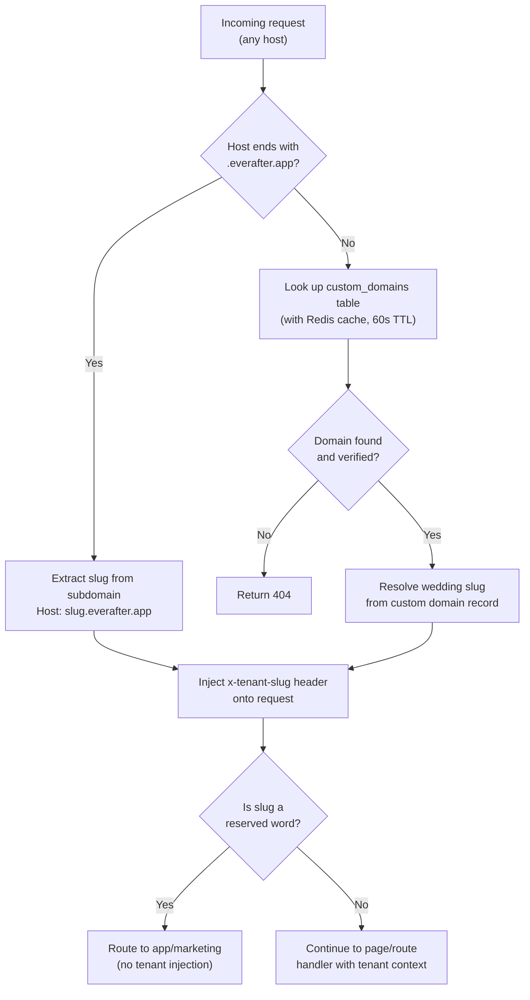

# ADR-002: Multi-Tenancy Approach — Subdomain-Based Tenant Routing

| Field | Value |
|-------|-------|
| **Status** | ✅ Accepted |
| **Date** | 2026-09-27 |
| **Author** | EverAfter Engineering |
| **Supersedes** | — |
| **Superseded by** | — |

---

## Context

EverAfter is a multi-tenant wedding website builder. Each tenant is a couple (or a couple managed by a wedding planner). Every couple needs:

1. A **publicly accessible wedding website** — discoverable by guests via a memorable URL.
2. A **private dashboard** — where the couple manages guests, RSVPs, seating, and content.
3. **Data isolation** — one couple's data must never be readable or writable by another.

As we scale to thousands of active wedding sites simultaneously, the routing and isolation strategy has significant consequences for the application architecture, infrastructure, DevOps complexity, and the guest experience.

We needed to decide: **how does the application determine which tenant's data to load for a given request?**

---

## Decision

**We use subdomain-based multi-tenancy.**

Each couple's public wedding site is served from a unique subdomain:

```
https://alex-and-jordan.everafter.app
https://the-smiths.everafter.app
```

Premium couples can additionally map a custom domain (e.g., `www.alexandjordan.com`) which the platform resolves to the correct tenant.

The couple's private dashboard is served from the root domain:

```
https://app.everafter.app/dashboard
```

Tenant identity is resolved at the **Next.js middleware layer** on every incoming request, before any page or route handler executes.

---

## Rationale

### Why subdomains over alternatives

The primary reasons for choosing subdomain routing:

1. **Guest experience:** `the-smiths.everafter.app` is immediately meaningful and shareable. Guests see the couple's identity in the URL bar, printed invitations, and QR codes. This is the dominant pattern in the wedding website market (Zola, Knot, Squarespace).

2. **Clean separation:** The couple's public site and EverAfter's dashboard/marketing site are logically and visually separate. There is no risk of couple-site UI leaking into dashboard UI via accidental URL patterns.

3. **Custom domain compatibility:** Mapping `www.alexandjordan.com → the-smiths.everafter.app` is straightforward with a CNAME and wildcard TLS certificate. This would be significantly more complex with path-based routing.

4. **Wildcard TLS:** A single wildcard certificate (`*.everafter.app`) covers all tenant subdomains, eliminating per-tenant certificate provisioning for the standard offering.

5. **Middleware tenant resolution is cheap:** Parsing the `Host` header in Next.js middleware is O(1) per request — a simple string split. No database lookup is required at the middleware layer.

---

## Options Considered

### Option A: Path-Based Routing (Rejected)

Each couple's site lives at a path under the root domain:

```
https://everafter.app/wedding/alex-and-jordan
https://everafter.app/wedding/the-smiths
```

**Pros:**
- Simpler DNS setup — single A/AAAA record, no wildcard certificate needed
- No subdomain resolution complexity in local development
- Easier to deploy to platforms with restricted DNS control (e.g., some PaaS providers)

**Cons:**
- ❌ Custom domains are practically impossible — `www.alexandjordan.com/wedding/alex-and-jordan` requires the custom domain to also carry the path, meaning the couple must host a redirect from their root or a subfolder. This is a poor UX.
- ❌ URL is less memorable and aesthetically poor on printed invitations
- ❌ Couples' sites sit under EverAfter's marketing path space, creating namespace collision risk (e.g., a couple named "pricing" or "login")
- ❌ Search engine indexing of couple sites could interfere with EverAfter's own SEO

**Verdict:** Rejected. Custom domain support (a key premium differentiator) is fundamentally incompatible with path-based routing.

---

### Option B: Subdomain Routing — **Selected** ✅

Each couple's site lives at a subdomain:

```
https://alex-and-jordan.everafter.app   (standard)
https://www.alexandjordan.com           (custom domain, premium)
```

**Pros:**
- ✅ Memorable, brandable URLs for couple's public site
- ✅ Seamless custom domain support via CNAME
- ✅ One wildcard TLS cert (`*.everafter.app`) covers all tenants
- ✅ Dashboard (`app.everafter.app`) is clearly separate from couple sites
- ✅ Middleware tenant resolution is trivially fast (parse Host header)
- ✅ Standard pattern in the market — guests already understand it

**Cons:**
- ⚠️ Local development requires extra setup (either `/etc/hosts` entries or a dev proxy)
- ⚠️ Some PaaS platforms require specific wildcard domain configuration
- ⚠️ Cookie scoping must be managed carefully (cookies on `everafter.app` are visible to subdomains by default — mitigated by using `app.everafter.app` for the dashboard with explicit domain scoping)

**Verdict:** Selected.

---

### Option C: Separate Deployments per Tenant (Rejected)

Each couple gets their own deployment (e.g., a separate Vercel project or serverless function stack):

```
alex-and-jordan.vercel.app (deployed separately)
```

**Pros:**
- Maximum isolation — a bug in one tenant cannot affect another
- Enables per-tenant configuration at the infrastructure level

**Cons:**
- ❌ Operationally unsustainable — thousands of couples = thousands of deployments
- ❌ Cold start latency per tenant
- ❌ Cannot share code updates across tenants without re-deploying every couple
- ❌ Stripe webhook handling, admin tooling, and planner features would require cross-deployment orchestration
- ❌ Cost is linear with tenant count rather than with traffic

**Verdict:** Rejected. This model is only practical for high-value enterprise accounts, not a freemium consumer SaaS.

---

### Option D: Database-Sharded Deployments (Rejected)

Route tenants to different backend instances based on a shard key, with separate databases per shard.

**Pros:**
- True data isolation at the database level
- Horizontal scaling per shard

**Cons:**
- ❌ Enormous infrastructure complexity for a team of this size
- ❌ Cross-shard queries (e.g., planner managing couples on different shards) become very hard
- ❌ Supabase's Row Level Security already provides robust tenant isolation without sharding
- ❌ Premature optimisation — Supabase + RLS scales to hundreds of thousands of rows per table without sharding

**Verdict:** Rejected. Supabase RLS is the appropriate isolation mechanism at this scale.

---

## Trade-offs of the Chosen Approach

### Pros

| Advantage | Detail |
|-----------|--------|
| Guest UX | Memorable, shareable URL on invitations and QR codes |
| Custom domains | CNAME-based mapping is standard and well-understood |
| Single wildcard cert | `*.everafter.app` covers all tenants; no per-tenant cert provisioning |
| Middleware efficiency | Host header parsing is synchronous and O(1) |
| Market familiarity | Guests expect this pattern from competitors |
| RLS isolation | Supabase Row Level Security enforces data isolation regardless of routing |

### Cons and Mitigations

| Disadvantage | Mitigation |
|-------------|-----------|
| Local dev complexity | `next-dev-proxy` or documented `/etc/hosts` entries; all team members use the same dev setup script |
| Cookie domain scoping | Dashboard uses `app.everafter.app`; auth cookies scoped to `app.` prefix. Public wedding sites do not require auth cookies. |
| Slug namespace collisions | Reserved slug list (`www`, `app`, `api`, `admin`, `mail`, `support`, etc.) enforced at creation time |
| Wildcard TLS on custom domains | Use Caddy or Cloudflare for automatic per-domain TLS provisioning (not the wildcard cert) |
| SEO — multiple subdomains | Each subdomain is an independent origin with its own `<head>` metadata, canonical URLs, and structured data |

---

## Consequences

### Codebase consequences

1. **Next.js middleware** (`src/middleware.ts`) is the canonical tenant resolution point. It must run on every public request and inject the resolved `tenantId` (or `tenantSlug`) into request headers for downstream use.

2. **All server components, server actions, and API routes** that serve couple-site content must read the tenant from the request header set by middleware — never from a URL parameter or query string on the public site.

3. **Supabase RLS policies** enforce data isolation as a second line of defence. Even if middleware resolves the wrong tenant (e.g., due to a bug), RLS prevents cross-tenant data reads. The `tenant_id` column on all tables must be indexed and used in every policy.

4. **The dashboard** (`app.everafter.app`) uses standard cookie-based session auth (Supabase Auth). It does not use the subdomain-tenant-resolution path — the couple's identity comes from their authenticated session.

5. **Slug uniqueness** is enforced at the database level (unique index on `weddings.slug`) and at the application level (validation + reserved word check before insert).

6. **Custom domain mapping** requires a `custom_domains` table storing `{ domain, wedding_id, verified_at, tls_provisioned_at }`. The middleware must check this table (with caching) for requests where the host does not end in `everafter.app`.

### Infrastructure consequences

1. A **wildcard DNS record** (`*.everafter.app → load balancer`) must be configured at the DNS provider.
2. A **wildcard TLS certificate** (`*.everafter.app`) must be provisioned and auto-renewed.
3. Custom domains require **per-domain TLS** — use Caddy's automatic HTTPS or Cloudflare's SSL-for-SaaS product.
4. The **`Host` header must be preserved** through all reverse proxies and load balancers (no header stripping).

---

## Implementation Notes — Next.js Middleware

### Middleware flow



### Middleware code

```typescript
// src/middleware.ts
import { NextRequest, NextResponse } from 'next/server';

const ROOT_DOMAIN = process.env.NEXT_PUBLIC_ROOT_DOMAIN!; // 'everafter.app'
const APP_SUBDOMAIN = 'app';
const RESERVED_SLUGS = new Set([
  'www', 'app', 'api', 'admin', 'mail', 'support',
  'help', 'status', 'blog', 'pricing', 'login', 'signup',
]);

export async function middleware(req: NextRequest) {
  const hostname = req.headers.get('host') ?? '';
  const url = req.nextUrl.clone();

  // Strip port for local development
  const host = hostname.replace(/:.*$/, '');

  // --- 1. Identify the subdomain or custom domain ---

  let tenantSlug: string | null = null;

  if (host === ROOT_DOMAIN || host === `${APP_SUBDOMAIN}.${ROOT_DOMAIN}`) {
    // Root domain or app subdomain — no tenant, serve marketing/dashboard
    return NextResponse.next();
  }

  if (host.endsWith(`.${ROOT_DOMAIN}`)) {
    // Standard EverAfter subdomain
    const subdomain = host.slice(0, host.length - ROOT_DOMAIN.length - 1);
    if (RESERVED_SLUGS.has(subdomain)) {
      return NextResponse.next();
    }
    tenantSlug = subdomain;
  } else {
    // Custom domain — look up in custom_domains (cached)
    tenantSlug = await resolveCustomDomain(host);
    if (!tenantSlug) {
      return new NextResponse('Not found', { status: 404 });
    }
  }

  // --- 2. Rewrite to the tenant's pages ---

  url.pathname = `/wedding/${tenantSlug}${url.pathname}`;

  const response = NextResponse.rewrite(url);
  // Make tenant slug available to server components via headers
  response.headers.set('x-tenant-slug', tenantSlug);

  return response;
}

export const config = {
  matcher: [
    // Run on all paths except static files and Next.js internals
    '/((?!_next/static|_next/image|favicon.ico|.*\\.(?:svg|png|jpg|jpeg|gif|webp)$).*)',
  ],
};

async function resolveCustomDomain(domain: string): Promise<string | null> {
  // In production: check Redis cache first, fall back to Supabase query
  // In tests: override with process.env.TEST_CUSTOM_DOMAIN_MAP
  const res = await fetch(
    `${process.env.INTERNAL_API_URL}/api/internal/custom-domain?domain=${domain}`,
    { next: { revalidate: 60 } }, // cache for 60s via Next.js fetch cache
  );
  if (!res.ok) return null;
  const { slug } = await res.json();
  return slug ?? null;
}
```

### Reading tenant context in server components

```typescript
// src/app/wedding/[slug]/page.tsx
import { headers } from 'next/headers';

export default async function WeddingPage({
  params,
}: {
  params: { slug: string };
}) {
  // params.slug is the source of truth here (set by the rewrite)
  // x-tenant-slug header is an additional verification layer
  const tenantSlug = params.slug;

  const wedding = await getWeddingBySlug(tenantSlug);
  if (!wedding) notFound();

  return <WeddingLayout wedding={wedding} />;
}
```

### Local development setup

Developers add the following to `/etc/hosts` (macOS/Linux) or `C:\Windows\System32\drivers\etc\hosts` (Windows) to test subdomain routing locally:

```
127.0.0.1   the-smiths.localhost
127.0.0.1   alex-and-jordan.localhost
127.0.0.1   app.localhost
```

Then set:

```env
NEXT_PUBLIC_ROOT_DOMAIN=localhost
```

The middleware will resolve `the-smiths.localhost:3000` → tenant slug `the-smiths`.

Alternatively, developers can use the dev proxy script (`pnpm dev:proxy`) which sets up a local Caddy or Nginx instance to route `*.localhost` to `localhost:3000` automatically.

---

## References

- [Next.js Middleware documentation](https://nextjs.org/docs/app/building-your-application/routing/middleware)
- [Vercel multi-tenant example](https://github.com/vercel/examples/tree/main/solutions/multi-tenant)
- [Supabase Row Level Security](https://supabase.com/docs/guides/auth/row-level-security)
- [Cloudflare SSL for SaaS](https://developers.cloudflare.com/cloudflare-for-platforms/cloudflare-for-saas/)
- ADR-001: Database Schema and Row Level Security Strategy
- ADR-003: Custom Domain TLS Provisioning (planned)
